

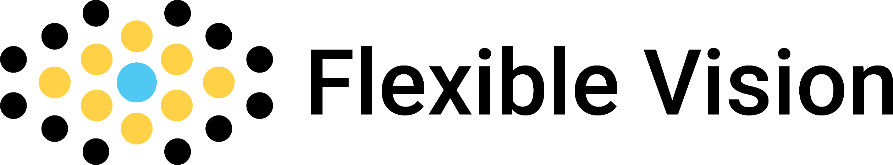

  

  

    <h1 class="big">Release Notes</h1>
    
Flexible Vision v2.0 &middot; Cloud and On-Prem

  

  

<b>Release date</b> &nbsp; 11 November 2026 
<b>Covers</b> &nbsp; March 2026 – November 2026 
<b>Applies to</b> &nbsp; Flexible Vision Cloud and Flexible Vision On-Prem

<b>About the screenshots in this document.</b> Every screen shown is the real v2.0 interface,
captured from a running unit and from the Flexible Vision Cloud. The product data in them —
part names, counts, defect figures and pass rates — is <b>sample data used for illustration</b>.
It does not represent the performance of any installation.

## Contents

1. [Highlights](#highlights)
2. [Dashboard](#dashboard)
3. [Cameras](#cameras)
4. [Live Video](#live-video)
5. [Camera Settings, Resolution and Rotation](#camera-settings-resolution-and-rotation)
6. [Calibration](#calibration)
7. [Snap & Find](#snap--find)
8. [Programs & I/O](#programs--io)
9. [Masking](#masking)
11. [Projects and Job Logs](#projects-and-job-logs)
12. [Metrics](#metrics)
13. [Time Machine](#time-machine)
14. [Waveform — new](#waveform--new)
15. [Visual Anomaly — new](#visual-anomaly--new)
16. [Worker Guidance and the Kiosk — new](#worker-guidance-and-the-kiosk--new)
17. [Help Center — new](#help-center--new)
18. [Node Creator and API Docs](#node-creator-and-api-docs)
19. [System Settings](#system-settings)
20. [Cloud](#cloud)
21. [Running without the internet](#running-without-the-internet)
22. [Security](#security)
23. [Upgrade notes](#upgrade-notes)
24. [Option reference](#option-reference)

## Highlights

- **A new look across the whole platform.** Cloud and On-Prem share one visual language: consistent colours, type and controls, light and dark themes, and layouts that hold up on phones, tablets and the touch panels actually used on a line.
- **Worker Guidance and the operator kiosk.** A complete station experience — configurable tabs and widgets, a product catalogue, a fault system with recovery actions, equipment monitoring, shift scheduling and an in-app Help Center — authored centrally and published to the line.
- **Three new inspection types.** Visual Anomaly finds defects having only seen good parts. Waveform listens for unusual sound and vibration. Segmentation outlines the part instead of boxing it.
- **Site Viewer as the control centre.** A 3D globe of your sites, line and station views, live activity timelines, analytics with alerting, and remote upgrade, rollback and restart.
- **It works without the internet.** Units register against a master on your own network, updates install from a USB stick, and a site running its own local cloud keeps control of its releases.
- **Collaborative tagging.** Several people annotate one project at once, with locks, presence, version history and restore points.
- **More cameras, better handled.** Opto Engineering joins Basler, Baumer and Omron/Sentech, and GigE cameras are discovered and addressed from the interface.
- **Tighter access control.** Device commands are authorised on the server, data access is scoped per device, and permission changes take effect without signing in again.

---

## Dashboard

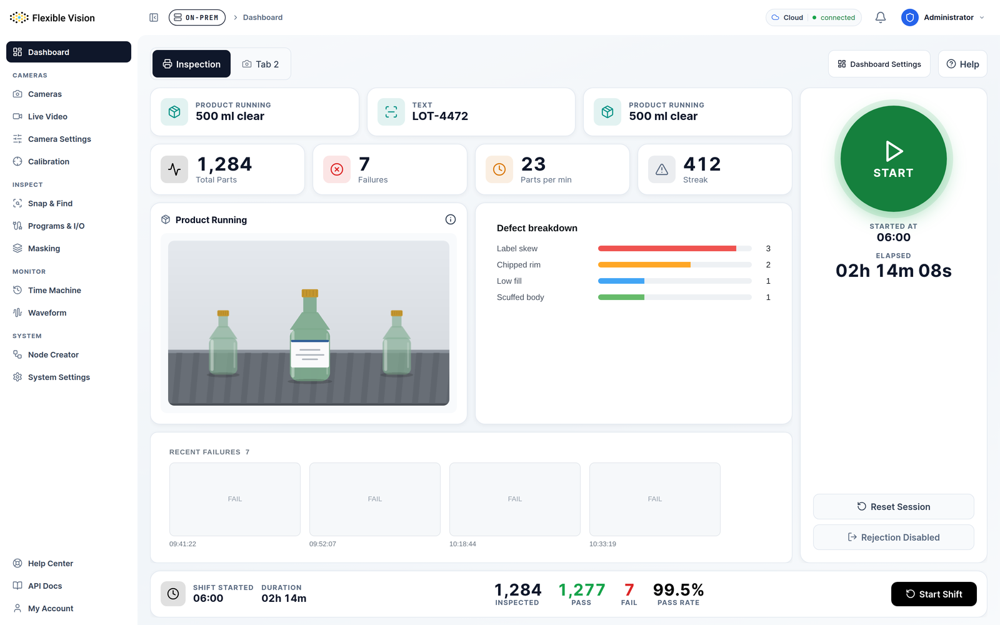
*The dashboard, rebuilt for v2.0.*

The dashboard is what an operator looks at all shift, so most of the work went into making it readable at a glance and cheap to leave running.

**What is new**

- **Tabs.** The dashboard is no longer a single fixed screen. Each tab holds its own cards and widgets, so one unit can present an inspection view and a line view without switching pages.
- **Your layout survives.** Widgets are kept when the number of available slots changes — previously a resize could reset an arrangement you had set up deliberately.
- **Critical alerts** are raised here rather than only in logs.
- **Recent Predictions** refreshes on its own timer instead of only when the page opens, and is given a fair share of the column rather than being squeezed.
- **Much lighter on the network.** Inspection images are now fetched from a cacheable address instead of being re-sent with every refresh. On a busy line with a long-running dashboard this is the single largest reduction in network load in the release.
- **Segmentation results** are drawn as outlines with a centre marker, not as boxes.
- **Send to cloud.** An administrator can push an inspection card to the cloud project, or into its validation set, directly from the dashboard — useful when an operator spots a case worth retraining on.

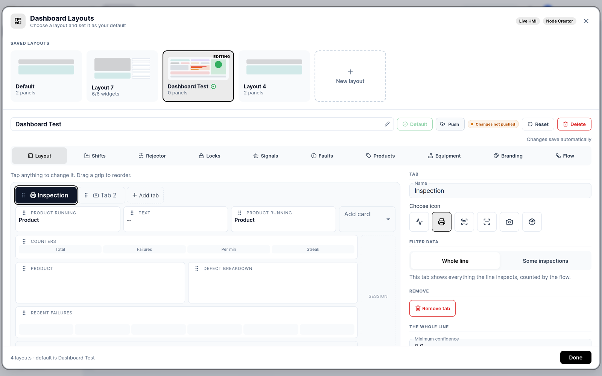
*Dashboard Settings — choosing the tabs, cards and widgets an operator sees.*

**The dashboard is configured, not coded.** Dashboard Settings is where the tabs are defined, each bound to a model and filtered on whatever matters at that station, and where the cards and widgets on each tab are chosen and arranged. The same editor manages kiosk layouts, product catalogues and branding where Assembly Guidance is in use.

**The shift bar** across the bottom reports the running shift: start time, elapsed duration, parts inspected, pass, fail and pass rate. Shifts can be started by hand or run to a schedule (see [Worker Guidance](#worker-guidance-and-the-kiosk--new)).

---

## Cameras

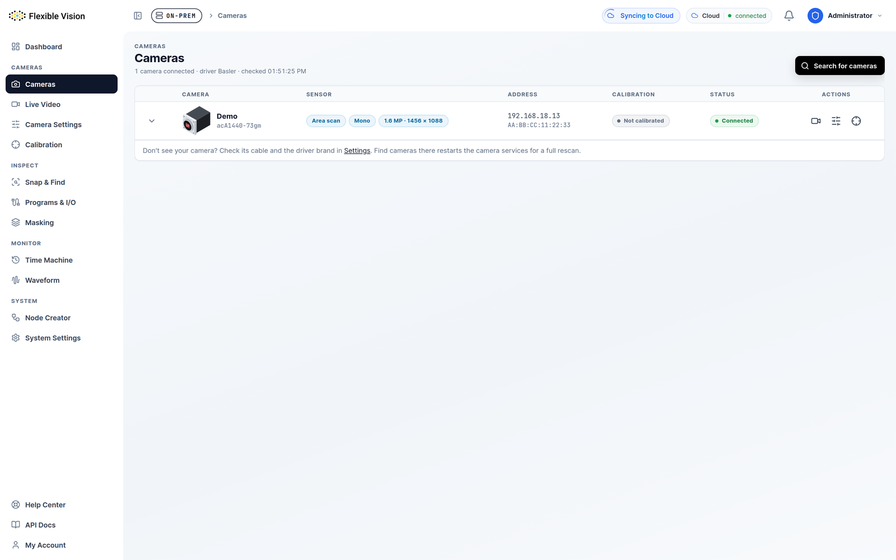
*Cameras — what is connected, its calibration state and per-camera actions.*

**Supported manufacturers**

| Manufacturer | Notes |
|---|---|
| **Opto Engineering** | **New in v2.0.** Needs a network address assigned before first use. |
| Basler | Reconnection and shutdown handling substantially improved |
| Baumer | — |
| Omron / Sentech | A static address set by hand now survives a power cycle |
| Third-party GigE | **New in v2.0** — discovered and listed, and addressable |

**What is new**

- **Set a camera's address where its address is shown.** Addressing moved out of a hidden row menu and onto the field itself. If the unit cannot reach the address you chose, it says so and explains why, rather than failing silently later.
- **Subnet warnings.** A camera on the wrong subnet is flagged, and the unit reads its own network ports and warns when a camera is plugged into a port that hands out addresses automatically — the most common cause of a camera that works once and then disappears.
- **"In use" is not a fault.** A camera already held open by a running inspection now reads as *in use*. Previously this looked like a failure.
- **Naming.** Renaming a camera keeps it selectable everywhere, a camera that never had a name is given one, and a camera whose name is unavailable is identified by serial number.
- **Link settings that the network cannot carry are refused** instead of being accepted and then failing intermittently under load.

---

## Live Video

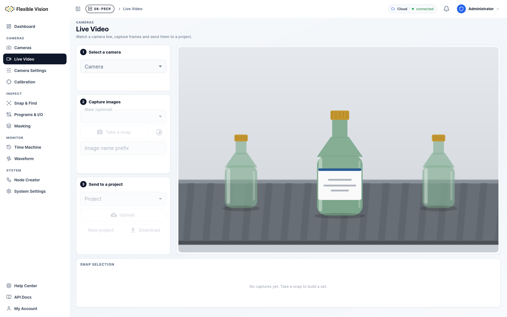
*Live Video — watch a camera, capture frames, send them to a project.*

The page is a three-step flow: **select a camera → capture images → send to a project**.

- **Newest capture first** in the reel. Previously the newest arrived at the end of a growing list.
- **A mask can be applied** at capture time, so the images you collect match what the inspection will actually see.
- **Captured frames upload straight to a cloud project**, or download locally, without a separate step.
- **Steadier streaming under load.** Viewers receive a smooth preview while full-quality frames continue to be recorded, overlay values update without restarting the stream, and settings changes take effect immediately rather than after stopping and starting the camera.

---

## Camera Settings, Resolution and Rotation

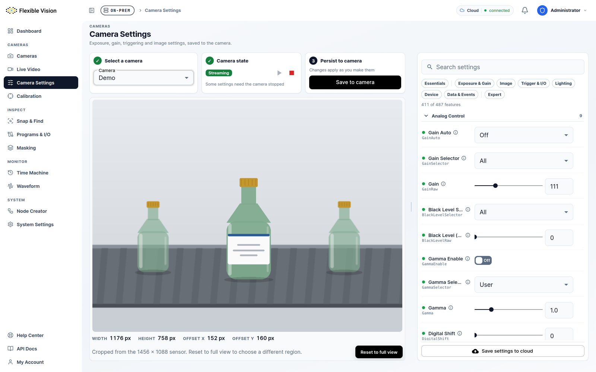
*Camera Settings — the camera's own features, grouped and searchable, with the live view beside them.*

Settings are grouped into **Essentials, Exposure & Gain, Image, Trigger & I/O, Lighting, Device, Data & Events and Expert**, with a search box across all of them — on this camera, 411 of 487 features are exposed. The live view sits alongside, and the crop readout reports the region in use against the full sensor, so a narrowed field of view is never a surprise.

- **Every setting is validated three times**: as you type, when you leave the field, and again when it is written to the camera. A value the camera cannot accept is caught at the keyboard instead of at the next inspection.
- Validation understands the type of each setting — whole numbers, decimals, fixed choices, on/off switches, text, network addresses and heartbeat intervals — so the error you get names the actual problem.
- **Time Machine** gains a *Sharper detail* option, and the overlay switches now show their true defaults rather than a guess.

**Resolution** and **Rotation** are set per camera on their own pages, each working against the live view.

---

## Calibration

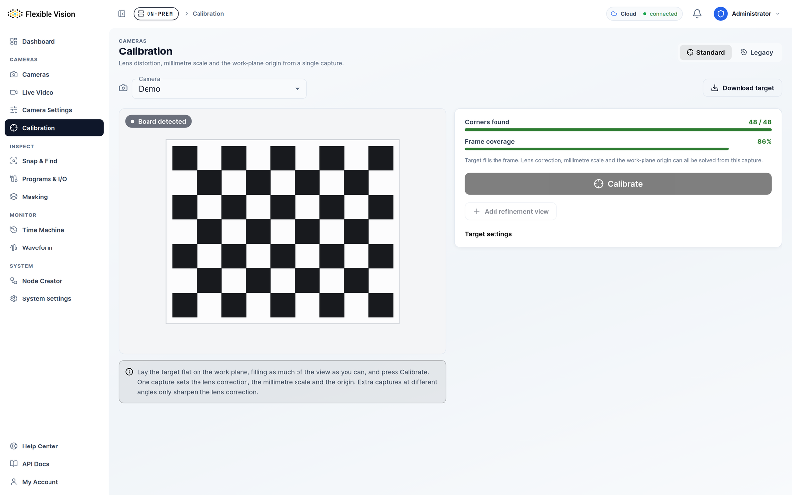
*Calibration — one capture sets lens correction, millimetre scale and the work-plane origin.*

Calibration establishes three things from a single capture of a printed target: **lens distortion correction**, the **millimetre scale** and the **work-plane origin**.

**What is new**

- **It tells you what it measured.** The field of view and the square size it assumed are now reported, so a calibration that silently used the wrong target size is obvious immediately instead of showing up later as measurements that are consistently out.
- **Live feedback while you position the target** — corners found against corners expected, and how much of the frame the target fills. A target too small in frame is called out, with the explanation that distortion is only visible near the edges.
- **Refinement views.** Extra captures at different angles sharpen the lens correction; the first capture alone is enough for scale and origin.
- The rotate-the-live-image option was removed, having caused more confusion than it solved.

---

## Snap & Find

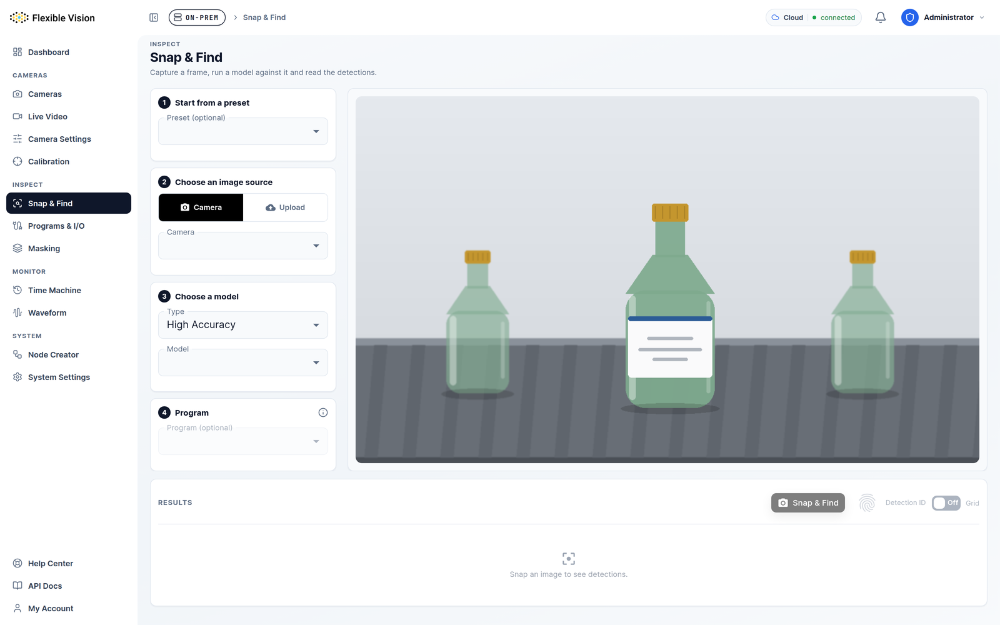
*Snap & Find — capture a frame, run a model against it, read the detections.*

A four-step flow: **start from a preset → choose an image source → choose a model → optionally attach a program**.

- **Start from a preset** to inherit a camera, model, mask and program in one click.
- **Image source** is either a live camera or an uploaded file, so a model can be tried against archive images without touching the line.
- **One inspection detail panel.** The results view here and on the dashboard are now the same component, so there is one thing to learn rather than two that behave slightly differently.
- **Segmentation outlines** are drawn on results, with a centre marker.
- **Detection ID and Grid** toggles control how results are labelled and laid out.

### Model types

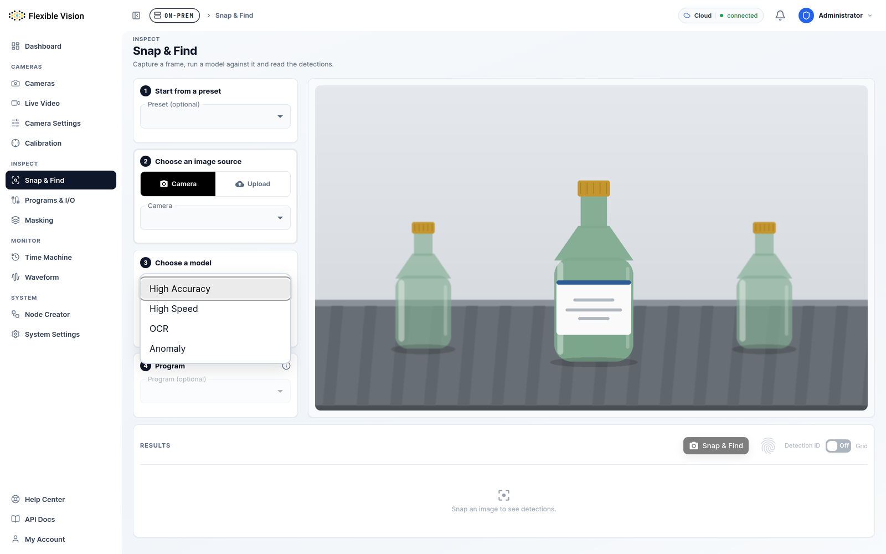
*Choosing a model type for a camera inspection.*

| Type | What it is for | Platform |
|---|---|---|
| **High Accuracy** | The standard detection model. Highest accuracy, highest compute cost. | x86 |
| **High Speed** | A lighter detection model for fast lines, where cycle time matters more than the last point of accuracy. | x86 and ARM |
| **OCR** | Reading text and characters inside an inspection. Requires the OCR service. | x86 and ARM |
| **Anomaly** | **New in v2.0.** Finds defects having only been trained on good parts. Requires the Visual Anomaly service. | x86 |

A model type whose service is not running on that unit is **hidden rather than offered**, so you cannot build a program that is guaranteed to fail when it triggers.

**Waveform is not in this list, by design.** It inspects a continuous sensor rather than a camera frame, so it is not something a camera preset selects. Waveform models are synced to the unit and bound to a sensor on the [Waveform](#waveform--new) page instead.

---

## Programs & I/O

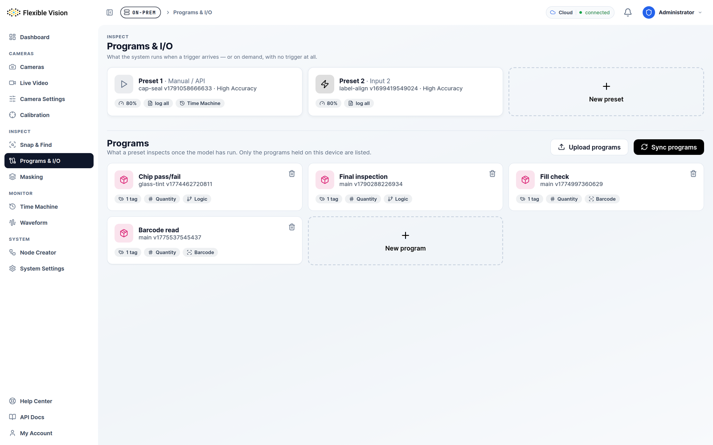
*Presets at the top, programs beneath. Each preset shows its trigger, model, version, confidence and logging at a glance.*

This is where you decide **what the system runs when a trigger arrives** — or on demand, with no trigger at all.

### Presets

A preset binds a trigger to a camera, a model and a program.

**What is new**

- **No limit on presets.** The previous cap of 10 is gone; a new preset simply takes the lowest free number.
- **Choosing a trigger is now a visual picker** rather than a pair of dropdowns, with room to enter TCP commands properly.
- **The two hardware trigger modes now explain what they do** instead of leaving it to be discovered by experiment.
- **Time Machine on failure** can be enabled per preset, so the seconds around a failure are kept for review without recording everything.

**Trigger sources**

| Trigger | Shown as | Behaviour |
|---|---|---|
| *(none)* | Manual / API | Runs on demand, from the interface or the API |
| **GPIO** | Input *N* | Fires on a hardware input |
| **TCP** | the command | Fires when the named command arrives over the network |
| **Camera I/O** | Camera push / Camera run | Driven by the camera's own trigger |
| **FTP** | FTP drop | Fires when a file is dropped into the watched location |

**Per-preset settings**

| Setting | Options | Notes |
|---|---|---|
| Model type | High Accuracy · High Speed · OCR · Anomaly | Only types whose service is running |
| Model and version | any on the device | Segment-capable versions are marked |
| Minimum confidence | **40 – 99** | Default 80. Anomaly defaults to 50, because anomaly alerting is calibrated during setup and does not mean the same thing as a detection score |
| Inference logging | **all · pass · fail · interval · off** | *interval* adds a "log every N seconds" field |
| Mask | optional | Limits the model to part of the frame |
| Program | optional | The checks run after the model |
| Time Machine on failure | on / off | Keeps the footage around a failure |

### Programs

A program is **what a preset inspects once the model has run**. Only programs held on that device are listed; others can be pulled down with **Sync programs** or brought in with **Upload programs**.

**Tools available in a program**

| Tool | Checks |
|---|---|
| **Quantity** | How many of a tag were found |
| **Barcode** | Barcode content |
| **Logic** | Rules combining other results |
| **OCR** | Text content |
| **Area** | Size of the found region |
| **Orientation** | Angle of the part |
| **Dimension** | Measured distances |
| **Histogram** | Intensity distribution |

The logic rule builder now **keeps a half-built rule** while you work on it, instead of discarding it as invalid.

---

## Masking

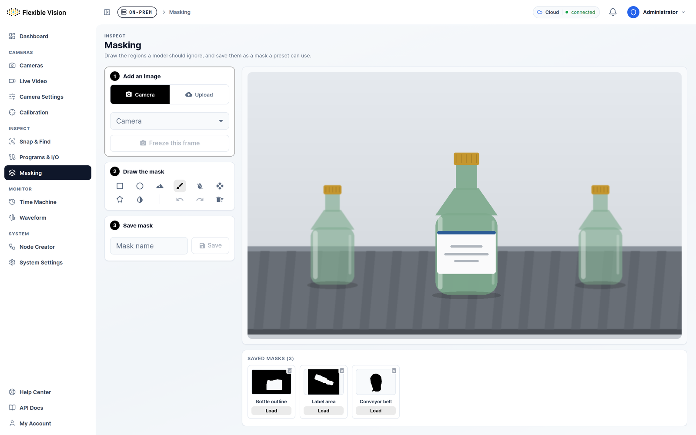
*Masking — draw the regions a model should ignore, and save them for a preset to use.*

A mask tells a model which parts of the frame to ignore — fixtures, conveyor, background, reflections.

- **The page fits the screen**, the image is fitted to its card, and **your drawing follows a resize** instead of drifting out of position.
- **Freeze this frame** captures a still from the live camera to draw against.
- **Drawing tools**: rectangle, circle, polygon, freehand brush, eraser, move, star and a contrast control, with undo, redo and clear.
- Selecting the brush no longer covers the canvas with a size menu, and a confusing toggle was removed from the segment panel.
- **Saved masks** are reusable across presets.

---

## Projects and Job Logs

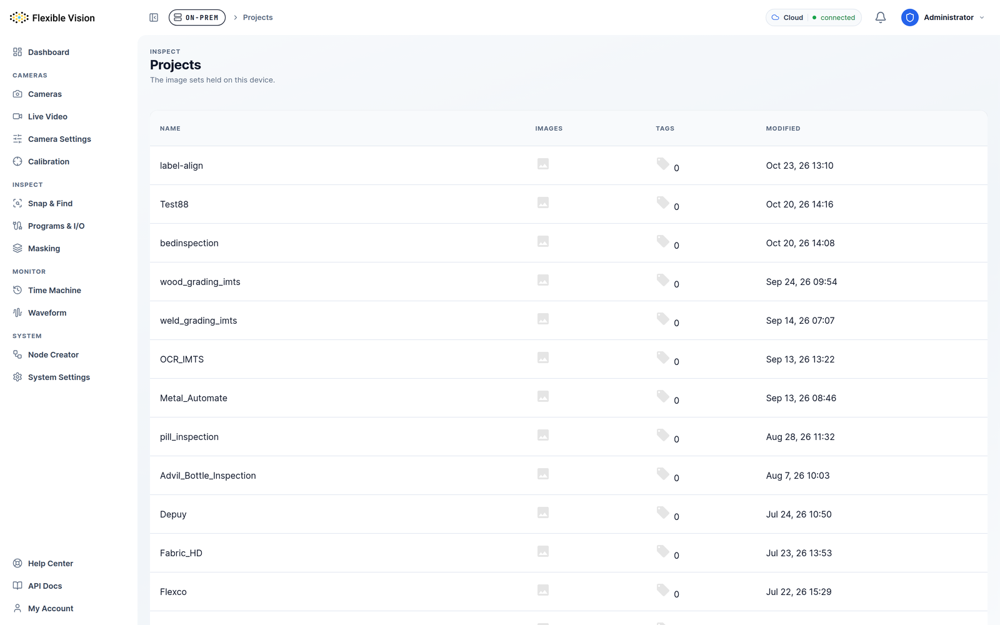
*Projects — the image sets held on the device.*

**Job Logs** lists every inference the unit has run, newest first, with the time, model, verdict, what was found and how long it took.

- **Paged 25 rows at a time** rather than rendering an entire history, which is what made long logs slow to open.
- **Tab labels stay on one line**, so the view is readable at panel width.
- **Shift logs download as a single report** rather than one file per shift.

---

## Metrics

**System Metrics** reports CPU, memory, disk and container health for the unit, in the unit's own timezone. It is not pictured here: the charts are served by a monitoring component that was not running on the unit these screenshots came from.

---

## Time Machine

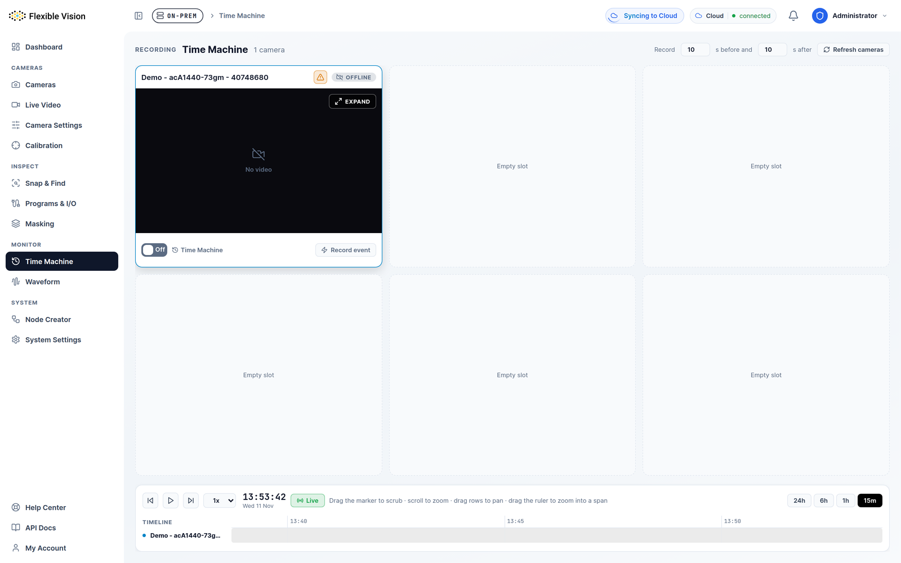
*Time Machine — rolling recording per camera, with a scrubbable timeline.*

Time Machine keeps a rolling frame history so you can go back and see exactly what the camera saw when something went wrong.

**Recording**

- **Pre-roll and post-roll are set in seconds** — by default 10 seconds before an event and 10 after — so a recorded event carries its run-up and its aftermath rather than the instant alone.
- **Each camera has its own slot and its own on/off toggle**, so you record the cameras that matter rather than everything.
- **Record event** captures on demand, without waiting for an inspection to fail.
- **Enable per preset on failure** from Programs & I/O, so the seconds around a failure are kept automatically.

**Playback**

- A **timeline** below the cameras, scrubbable by dragging the marker, with scroll to zoom and drag to pan.
- **Range buttons — 24h, 6h, 1h, 15m** — to move between a shift-long view and a few minutes around an event.
- **Live** indicator and variable playback speed.

**Quality**

- A **Sharper detail** option in Camera Settings for higher-quality retention.
- Overlay switches show their real defaults.
- Streaming was reworked so recording keeps every frame while viewers receive a lighter preview, and a recording that fails to start is reported as a failure rather than silently recording nothing.

## Waveform — new

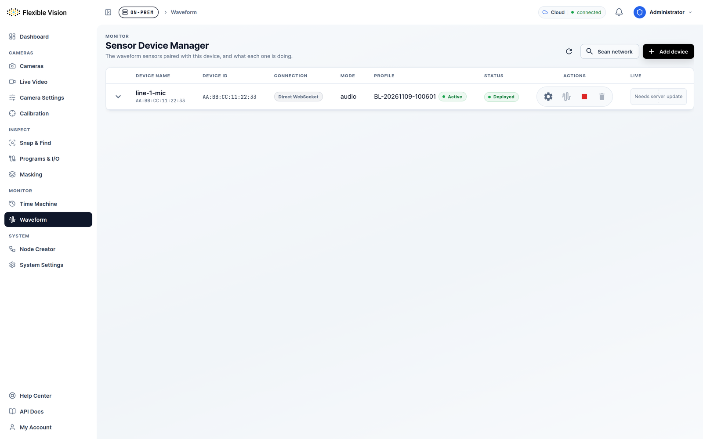
*The Sensor Device Manager — every paired sensor, its connection, mode, profile and status.*

Waveform appears in the sidebar under **Monitor** once its service is enabled, and opens on the **Sensor Device Manager**: every sensor paired with the unit, how it is connected, what mode it is in, which profile it is running, and whether its model is deployed. Sensors are found with **Scan network** or entered by hand with **Add device**.

Waveform listens to a continuous sensor — a microphone, an accelerometer — learns what normal running sounds like, and raises an anomaly when something does not fit. It inspects what a camera cannot see: a bearing starting to fail, a part seating incorrectly, a crack you would otherwise only hear.

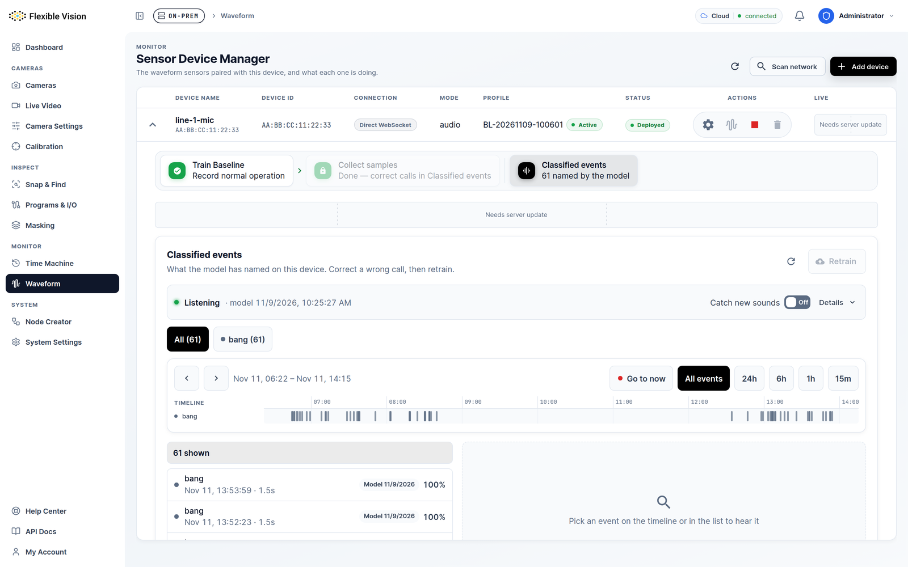
*A sensor expanded — its three-stage pipeline, and the events the deployed model has named.*

Expanding a sensor shows **where it is in its pipeline**: Train Baseline, Collect samples, then Classified events. A stage that is finished is marked, and one that no longer applies is locked with the reason given — in the example above, Collect samples reads *"Done — correct calls in Classified events"* because this sensor already has a model deployed.

**Classified events** is where a deployed model is corrected: every sound it has named, filterable by class, on a timeline with 24h / 6h / 1h / 15m ranges, each with its time, duration and confidence. Correct a wrong call and **Retrain** folds it back into the next model. A **Catch new sounds** toggle decides whether unfamiliar sounds are collected as well.

### Two kinds of signal

The first question asked is which kind you have, because they are handled differently:

- **Event** — a discrete sound. An impact, a crack, a click. The system detects it for you.
- **Process** — a bounded cycle with its own start and finish, marked by the machine rather than detected.

A project is created for one of these and keeps it.

### Setup presets

Rather than asking for raw numbers, setup starts from a preset matched to what you are listening to. Each sets a sensitivity, a detection profile and how much normal running it needs before it can judge anything.

**Audio**

| Preset | Sensitivity | Profile | Baseline needed |
|---|---|---|---|
| Environment | 8.0 | High | 20 s |
| Rotating Equipment | 7.0 | Medium | 30 s |
| Tools & Assembly | 6.0 | Medium | 1 min |
| Production Line | 7.0 | Low | 2 min |

**Vibration and other signals**

| Preset | Sensitivity | Profile | Baseline needed |
|---|---|---|---|
| Baseline Signal | 8.0 | High | 20 s |
| Vibration & Rotation | 7.0 | Medium | 30 s |
| Cyclic Process | 6.0 | Medium | 1 min |
| Multi-State Process | 7.0 | Low | 2 min |

A higher sensitivity reports more; a lower detection profile is more tolerant of normal variation. Both can be adjusted after the preset is applied.

### Collecting and training

- **Record a baseline** of normal running. If the sensor is not actually streaming you are told, instead of training on silence and having everything afterwards look abnormal.
- **Each event gets its own clip.** Where several events happen in quick succession they are separated, rather than one clip containing all of them and the model learning the wrong thing.
- **An event arriving during another capture is still kept** — previously the second event in a burst was lost.
- **The display marks where in the clip the sound occurred**, so review means looking at the event rather than hunting through several seconds of audio.
- **Continuous recording** within a disk budget you set, so an event can be recovered from what already happened.
- **Train in the cloud from the unit**, bring the model back, deploy it, and retrain as you collect more examples.
- **Classified events view** and a readable activity log for what the deployed model is calling.

---

## Visual Anomaly — new

Finds surface defects and missing content **having only been shown good parts**.

This matters because of what it removes. Conventional defect detection needs labelled examples of every defect you want to catch — which means waiting for defects to occur, collecting them, and starting again when a new one appears. Most defect-detection projects stall there. Visual Anomaly learns what a correct part looks like and reports anything that departs from it, so you can be inspecting within a shift of installing it.

- **Guided setup wizard** with thresholds calibrated against your own parts, so the alert level means something on your line.
- **Finds the defect you did not plan for**, because it is not working from a list of known defects.
- **Appears as a model type** once enabled, and its results flow into the same views as every other inspection.
- **Reporting distinguishes "nothing found" from "nothing checked"** — a distinction a single percentage cannot make.
- **x86 units only.**

---

## Worker Guidance and the Kiosk — new

The kiosk is the operator-facing station view: what to build, how to build it, what has failed, and what to do about it. It is configured centrally and published to the line.

**Tabs and widgets**

- Each tab holds **its own cards and widgets**, is bound to a model, and can be filtered on any inspection field.
- Tabs show the **live counts** for their flow, and those counts **survive an operator leaving the page and returning**.
- **Recent failures** shows only what failed, rather than a reel of everything.
- Layouts are arranged in an editor with a **true-to-shape preview**, so what you lay out is what appears on the panel.

**Product catalogue**

- Your own product fields, with the **part picture shown by default** and details behind an information button.
- Catalogues are managed centrally and assigned to one station or many.

**Faults**

- Faults are **defined in the interface**, not commissioned as bespoke logic.
- A fault is **raised as a modal the operator must deal with**, not a banner beside the tabs that can be worked past.
- Faults carry **recovery instructions**, and **never clear themselves** — a fault always behaves the same way.
- A **preset library** ships with it, and a fault can be **tested safely with real values shown** before it goes live.

**Equipment monitoring**

- Health checked on a schedule, with changing values graphed, state changes marked, and history sent to the cloud.

**Shifts**

- **Run to a schedule** instead of waiting on a button.
- **Configurable length** rather than a fixed eight hours.
- A shift that **ends on its own is recorded** rather than vanishing.
- Logs download as **one report**.

**Branding** — your logos and colours are applied and survive configuration changes made at the station.

---

## Help Center — new

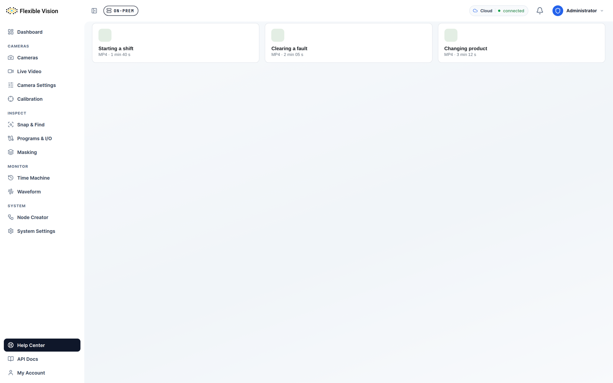
*Help Center — manuals and tutorial videos kept on the device.*

The Help Center holds the documentation an operator needs at the line, on the unit itself, so it works whether or not the site is online.

- **Two libraries: Manuals and Tutorial Videos**, each uploaded from the **Upload** button and opened in the app rather than downloaded.
- Documents are stored on the unit's filesystem with safeguards against partial writes, so an interrupted upload cannot leave the library unreadable.
- **The kiosk has its own Help panel**, reachable without leaving kiosk mode so an operator can get help without stopping the line. It presents the same manuals and tutorials alongside station context — overview, faults, signals and equipment.

---

## Node Creator and API Docs

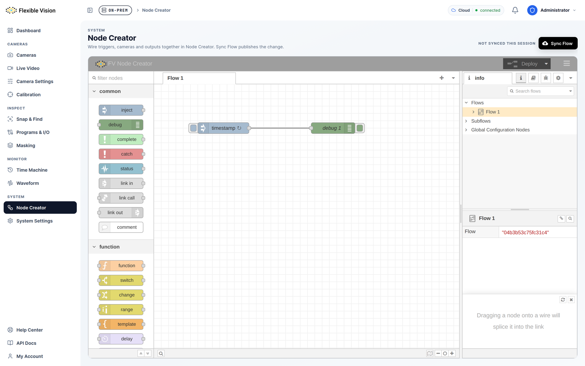
*Node Creator — wiring inspections to equipment and I/O.*

Node Creator is unchanged in v2.0, and **your flows are carried across an update**. Faults defined in the kiosk now appear here as generated logic.

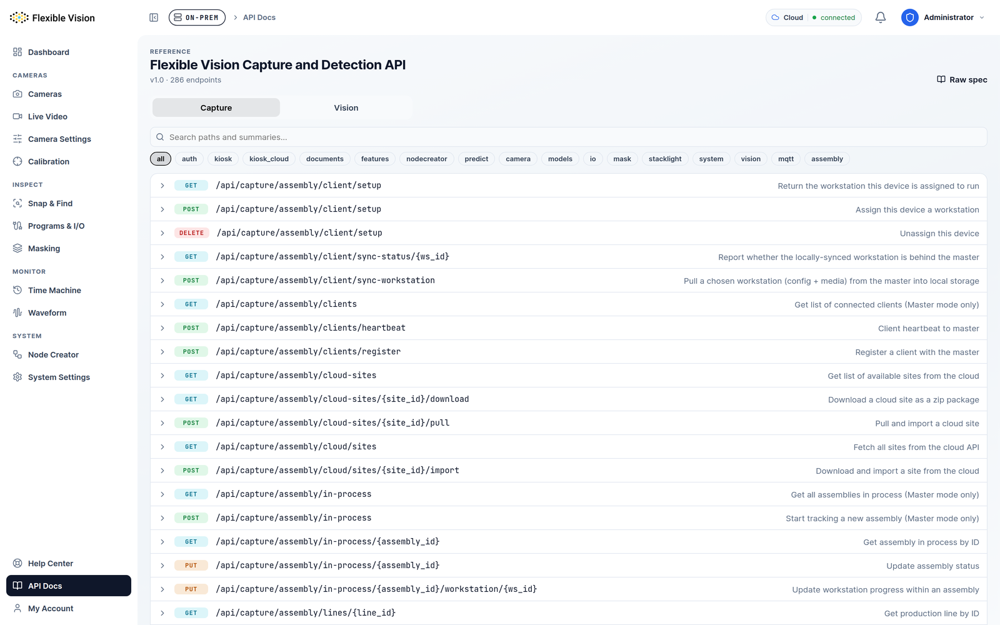
*API Docs — the live API reference, in the app's own theme.*

---

## System Settings

*System Settings.*

### Features

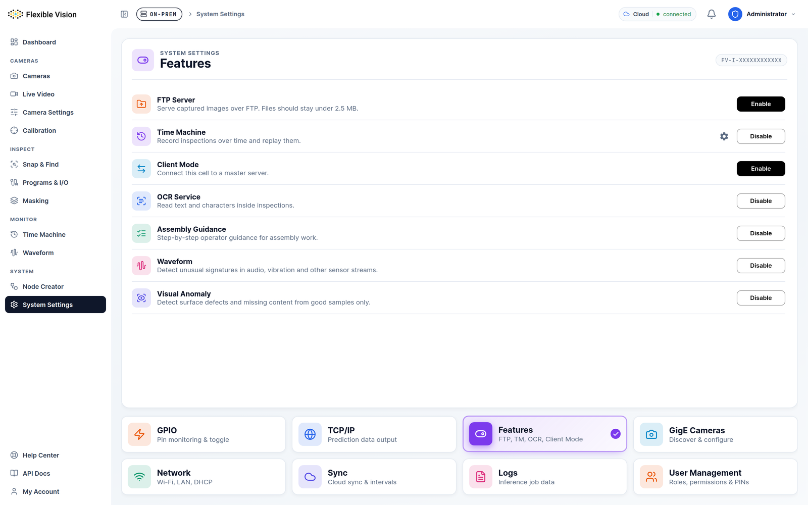
*Features — seven optional services, each enabled on the unit that needs it.*

Optional capabilities are enabled **per unit**, so a unit only carries what it is for:

| Feature | What it adds |
|---|---|
| **FTP Server** | Serves captured images over FTP. Files should stay under 2.5 MB |
| **Time Machine** | Records inspections over time and replays them |
| **Client Mode** | Connects this cell to a master server |
| **OCR Service** | Reads text and characters inside inspections |
| **Assembly Guidance** | Step-by-step operator guidance and the kiosk |
| **Waveform** | Detects unusual signatures in audio, vibration and other sensor streams |
| **Visual Anomaly** | Detects surface defects and missing content from good samples only — **x86 only** |

A feature that is off is **hidden rather than offered**, everywhere it would otherwise appear — including its entry in the sidebar, so the navigation reflects what the unit can actually do.

### User Management — roles, PINs, timezone and updates

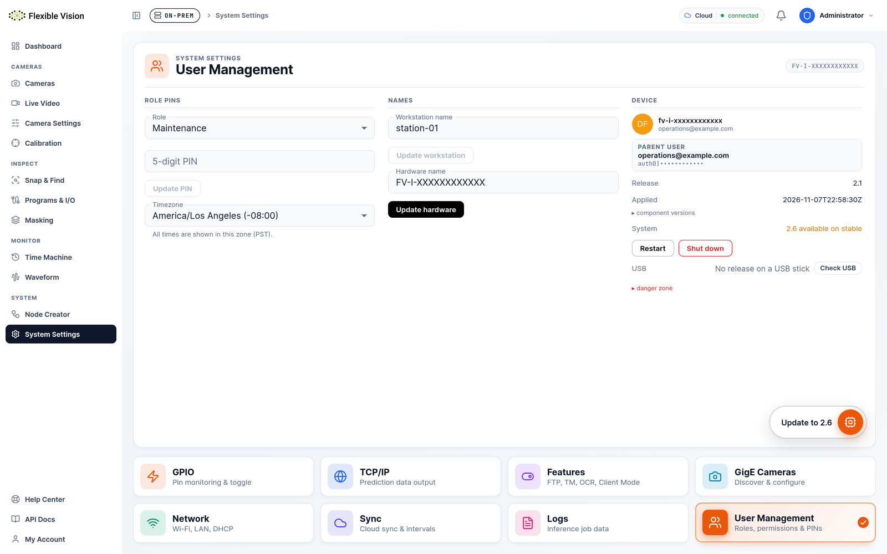
*User Management — role PINs, the unit timezone, its names, and the release it runs.*

This one screen carries several of v2.0's changes.

**Role PINs.** Each role is given a five-digit PIN.

| Role | Reach |
|---|---|
| **Administrator** | Full access, including system settings |
| **Maintenance** | Cameras, models and presets |
| **Viewer** | Watch inspections. No code needed, and signs in without one |
| **Supervisor** | Appears where Assembly Guidance is in use; bypasses guidance steps and nothing else |

**Timezone.** One timezone for the unit, set only by an administrator. The machine clock follows it, and **every time shown in the app uses it** — logs, shifts, analytics and reports — with the zone stated under the field so there is no ambiguity. A clock that failed to move says so rather than silently disagreeing with the cloud.

**Names.** The workstation name and the hardware name are set here, so a unit can be identified by where it stands rather than by its serial.

**Release control.** The panel reports the release the unit runs, when it was applied, and its component versions. When something newer is offered it says so — *2.6 available on stable* — with a single action to take it, and a rollback to return to the previous release. **Restart** and **Shut down** sit alongside, and **Check USB** reports whether a release is present on a plugged-in stick. Irreversible actions are kept behind a **danger zone** disclosure.

### GPIO

*GPIO — pin monitoring and toggle.*

Watch the state of each input and output, and toggle an output by hand to prove wiring before a preset depends on it.

### TCP/IP

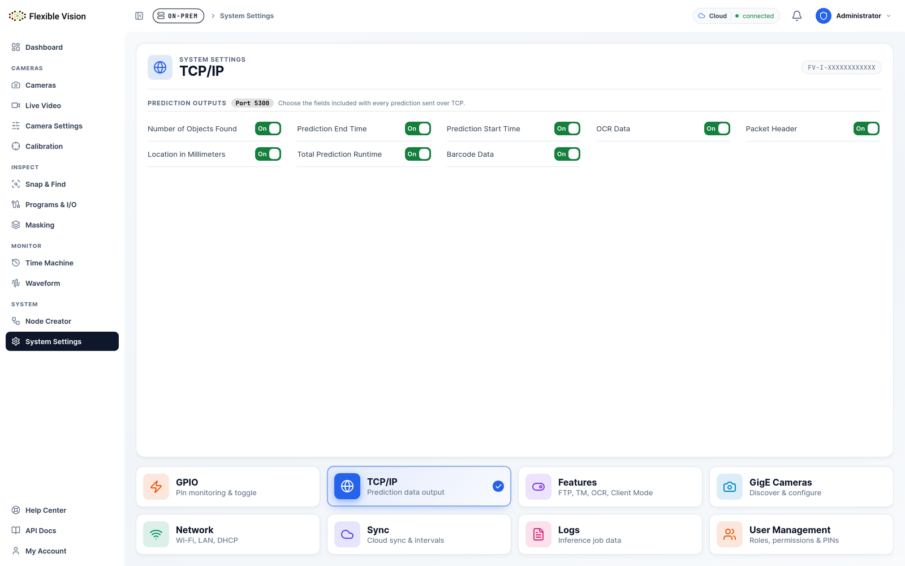
*TCP/IP — prediction data output.*

Where inspection results are pushed on the network, for a PLC or line controller consuming verdicts directly.

### GigE Cameras

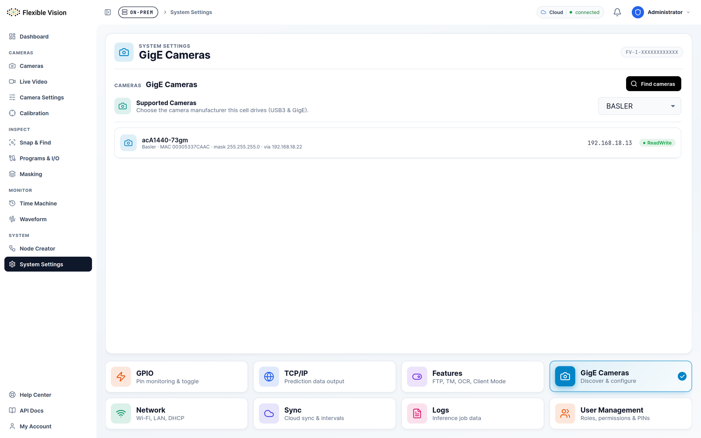
*GigE Cameras — discover and configure.*

Discovery and addressing for GigE cameras, including third-party devices, through one path shared with the Cameras page.

### Network

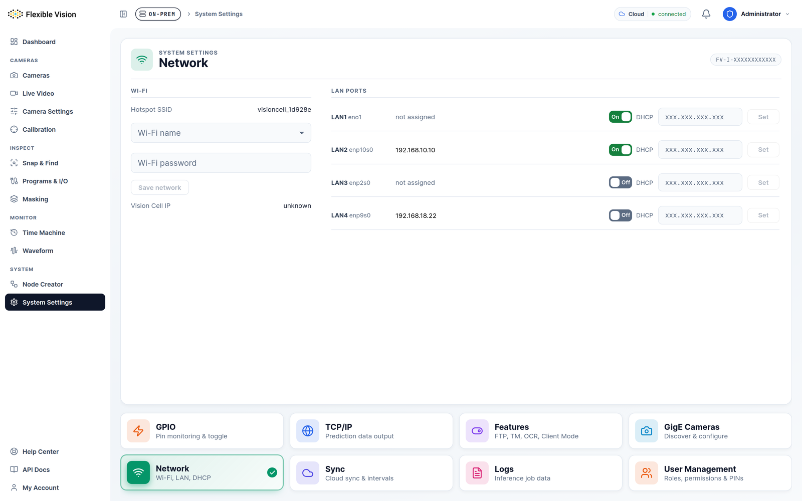
*Network — Wi-Fi, LAN and DHCP.*

The unit's own networking: wireless, wired and address assignment.

### Sync

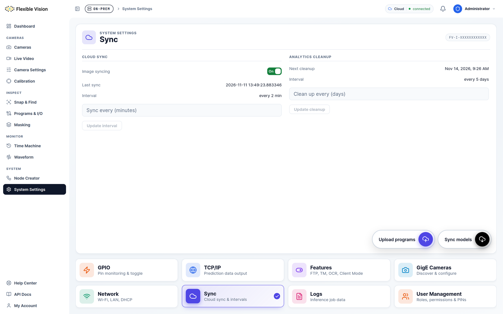
*Sync — cloud sync and intervals.*

What the unit sends to the cloud and how often.

### Logs

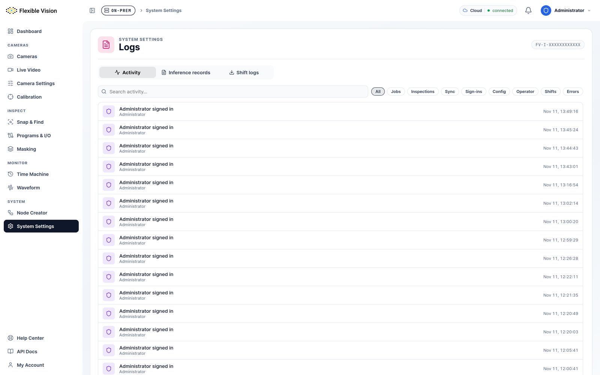
*Logs — inference job data.*

Inference job history held on the unit, paged rather than rendered in full.

### Model sync

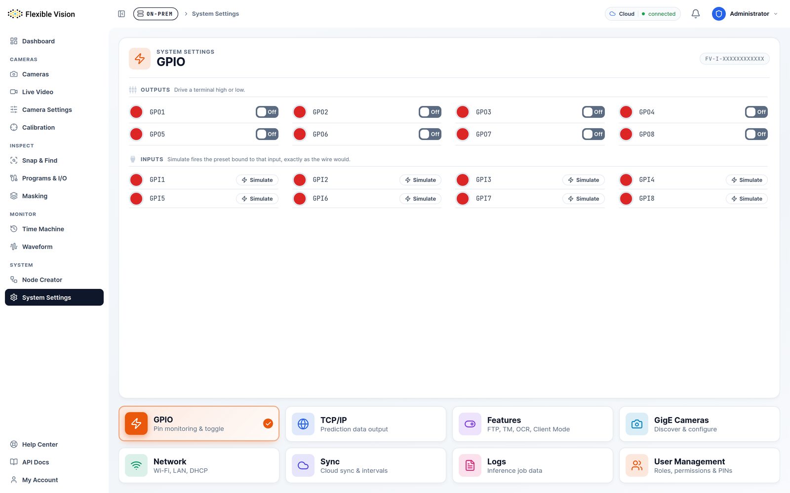
*Cloud Sync — bringing trained models down to the unit.*

Models trained in the cloud are brought down here, by type. **Sync** fetches what is missing, **Clean & Sync** replaces what is held, and **Full Sync** retrieves everything the project offers.

### Diagnostics

**Interface stalls are recorded** and kept across restarts, so an intermittent problem can be investigated after the fact rather than reproduced on demand.

---

## Cloud

The cloud application is where projects are tagged, models are trained and graded, and a fleet of units is watched and updated. v2.0 rebuilt it on the same design system as On-Prem, so the two read as one product.

**Signing in.** An account that belongs to an organisation should use **Sign in with organization** and enter the workspace name. Entering the email address first reaches the identity provider and then returns to the workspace prompt.

### Projects

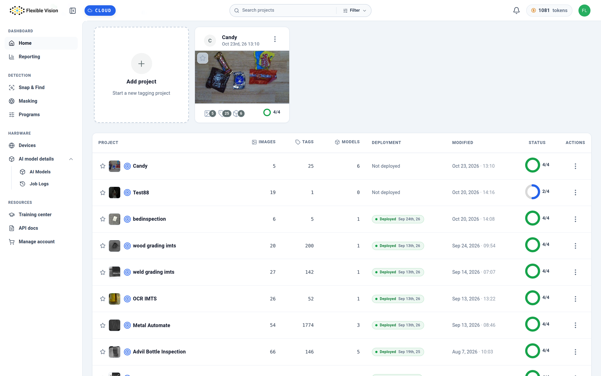
*Projects — every tagging project in the workspace.*

- **Favourites, filters, thumbnails and scroll paging**, with search that covers every project rather than the page you are on.
- **Pins are saved to your account**, so the projects you work on follow you between machines.
- **Private projects** show a lock and can be toggled from the table.
- **Add project** starts a new tagging project.

### Reporting

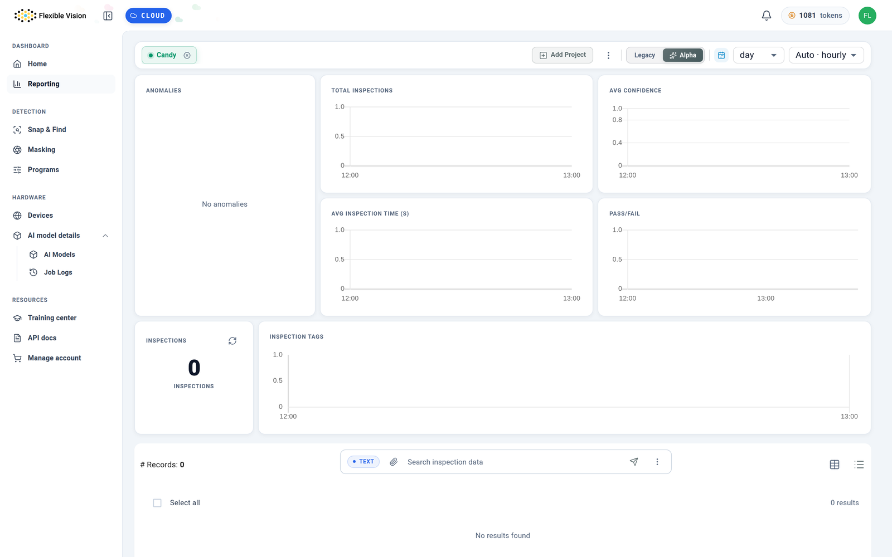
*Reporting — inspection results across the workspace.*

- The **advanced filter drives the graphs**, not just the table, and the table refreshes when you change tab or period.
- **Failure reasons are drawn from real pass/fail data.**
- **Prediction images keep their true aspect ratio**, and charts fill their row.
- Figures are shown in the **site's own timezone**, not the viewer's.

### Snap & Find, Masking and Programs

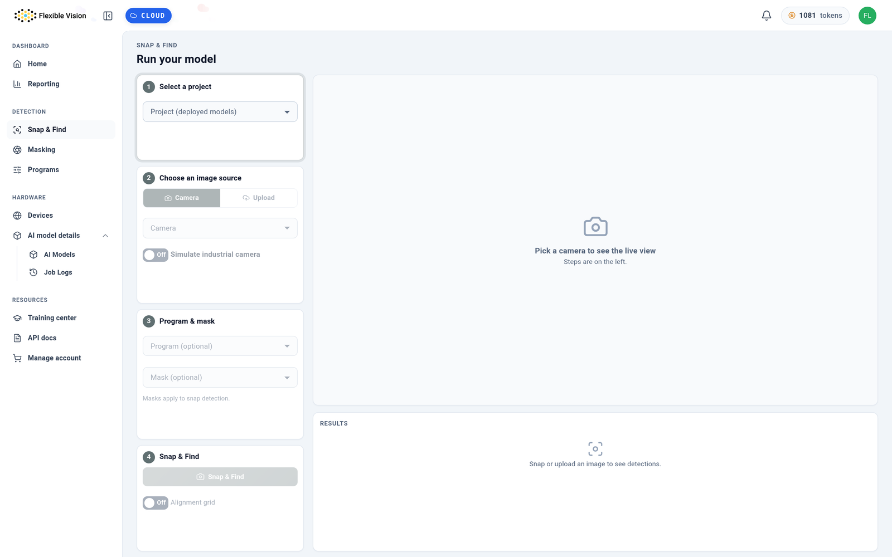
*Snap & Find — run a model against an image from the browser.*

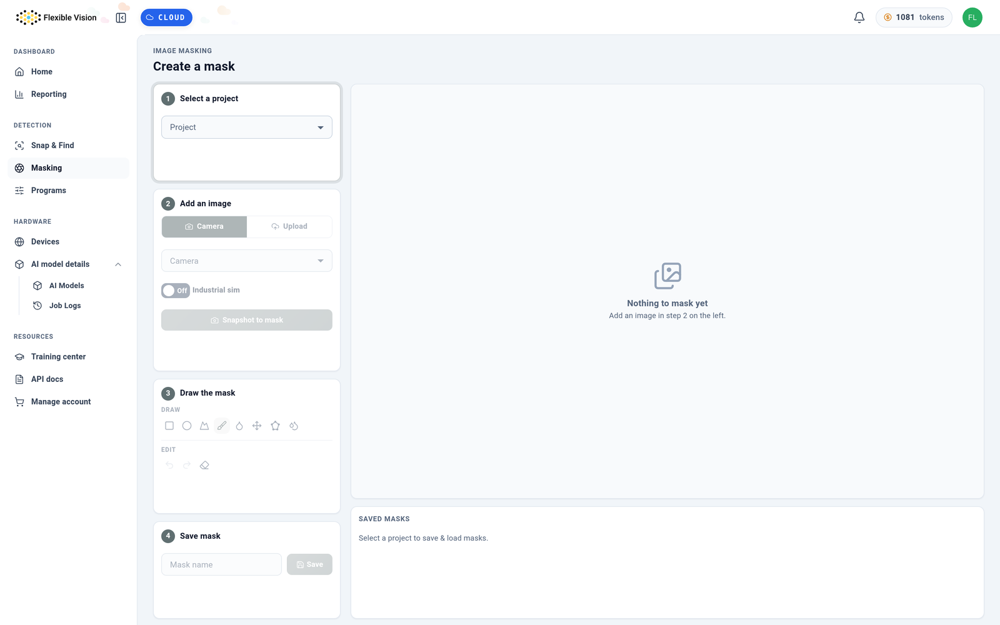
*Masking — the same drawing tools as On-Prem.*

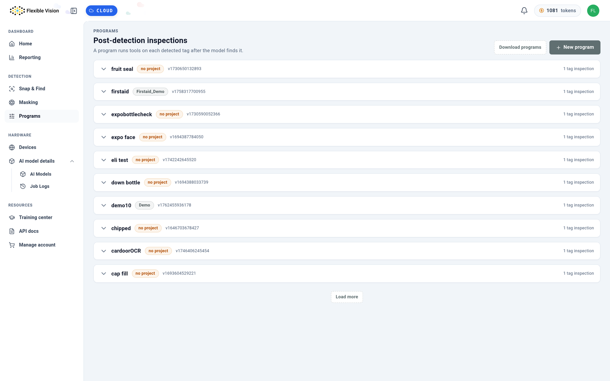
*Programs — the checks that run after a model.*

The detection tools are now the same on both sides: one detection overlay for every prediction view, drawn in each tag's colour, and segmentation shown as outlines with a centre marker. A **mobile camera** is available for adding images from a phone.

### Devices and Site Viewer

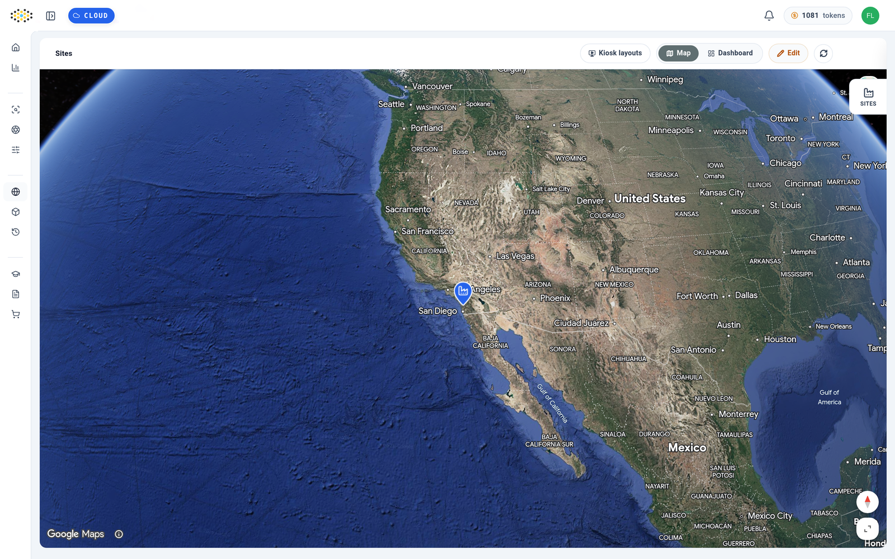
*Site Viewer — a 3D globe of your sites, with Map, Dashboard and Kiosk layout views.*

This is the control centre for a fleet.

- **A 3D globe of your sites**, with interactive pins, live cards and a route into each site's dashboard.
- **Add a site by address** — look it up, and the site is created and placed for you.
- **Edit on the canvas**: add, link, duplicate and delete sites, lines and stations. Duplicating a station copies its guidance.
- **Kiosk layouts** are assigned from here to one station or many, along with product catalogues and branding.
- **Activity timeline** per line and station, grouped by serial number, with shift bands and a scrubber; lines open on the last 24 hours.
- **Equipment** availability, health and history.
- **Remote release control** — see what a unit runs and on which channel, update it, roll it back, and review recent commands. It says *Up to date* when nothing newer is offered.
- **Devices deauthorise themselves** rather than being removed from the cloud side.

### AI Models

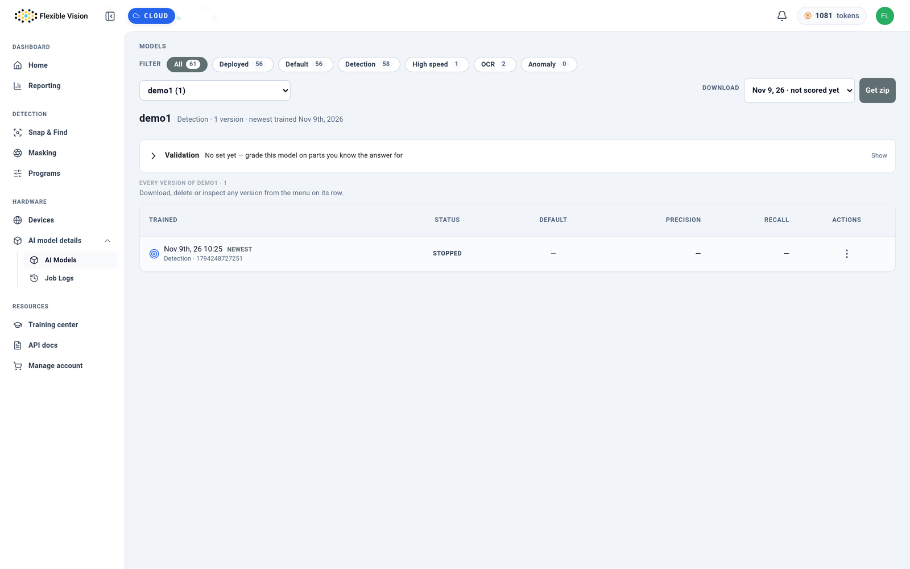
*AI Models — filter by type, grade a version, and compare precision and recall.*

- **Filter by type with live counts** — All, Deployed, Default, Detection, High speed, OCR and Anomaly — so a large workspace stays navigable.
- **Every version of a model** is listed with when it was trained, its status, whether it is the default, and its **Precision** and **Recall**. Those two were previously labelled Accuracy and Coverage, which described them poorly.
- **Validation.** Grade a model version against a fixed set of parts whose answer you already know, with a verdict matrix, a threshold sweep and comparison between versions — so a model is judged before it reaches the line rather than after.
- **Download a version** as a zip, and inspect, delete or set a default from the menu on its row.
- **Training** runs can be cancelled, and a previous version's configuration reused.

### Job Logs

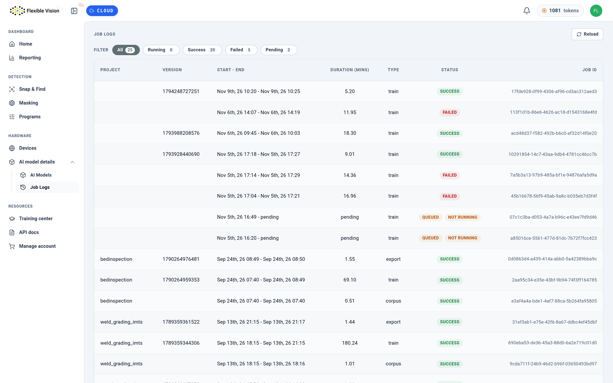
*Job Logs — training and processing history.*

Training and processing jobs, with their state and history.

### API docs and account

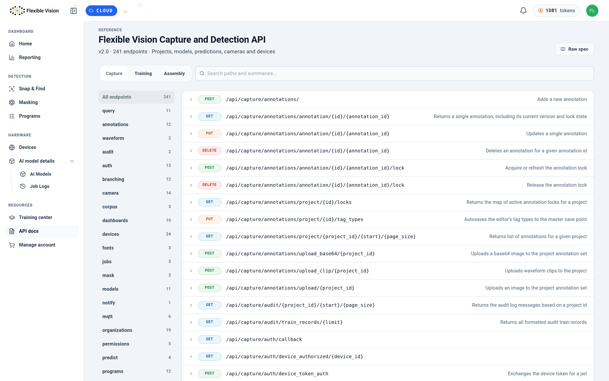
*API docs — the live API reference, in the app's theme.*

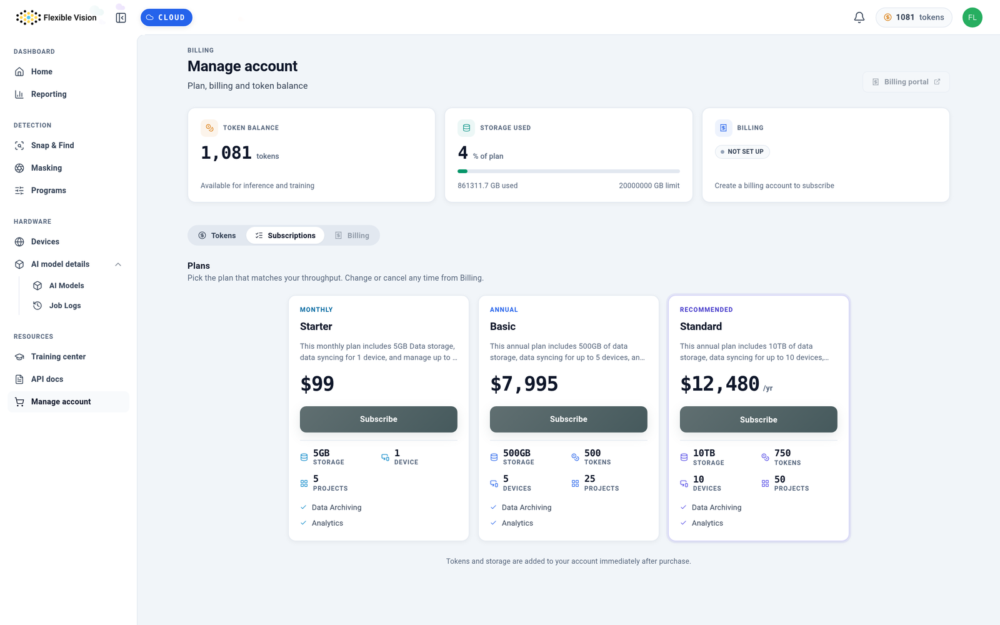
*Manage account — workspace, members and consumption.*

- **API docs** render the live reference inside the app rather than sending you elsewhere.
- **Manage account** carries the redesigned Admin Console: a Consumption page, member management that lists each member's devices, and a reworked Branding page.
- **Token balance** is shown in the header.

### Tagging

- **Rebuilt and collaborative** — several people on one project, with check-out locks, per-image locks, presence avatars, version history and restore points.
- Background saves with a timeline and minimap.
- Segmentation editing, selective tag copy, merging tag types on rename, and OCR custom fonts.
- **On-prem tagging autosaves each image** and has a single Save button.
- **Deleting an image stays deleted**, makes no checkpoint, and can be undone.

### Worker guidance authoring

- **Publish instructions to the unit**, with confirmation that the push arrived.
- **A cover photo** on the opening step, carried through to the station.
- **Hidden step parameters** — information the line records with a step without putting it in front of the operator; these can be made mandatory.
- **Validate Previous Station** sits at the start of the build.
- Inspection steps **open the inspection that ran**, with image, detections and verdict.

## Running without the internet

- Units **register against a master on your own network**, with no round trip to the public internet.
- A site running its **own local cloud keeps control of its releases**.
- **Updates install from a USB stick**, including the first install on a unit that has never been online.
- **Online status is checked against the master**, so a site with no external connection is not reported as offline.
- Features that only exist in the cloud are **hidden rather than offered and then failing**.

---

## Security

- **Device commands are authorised on the server.** Update, remote support, reboot and shutdown are checked against your role rather than trusted from the browser, and only administrators see them.
- **Access is scoped per device**, never granted fleet-wide.
- **Permission changes take effect without signing in again.** Removing someone's access takes effect while they are using the app.
- **Orderly deauthorisation.** A unit tells the cloud it is unlinked before clearing its credentials, and keeps its identity rather than reappearing as a new device.
- **The on-site message broker is closed to other hosts**, and the connection to the cloud is verified before it is trusted.
- Fixes to organisation sign-in, including a case where a removed member could become stuck at the login screen.

---

## Upgrade notes

- **Features are enabled per unit** in System Settings. **Visual Anomaly requires an x86 unit.**
- **Set the unit's timezone after upgrading.** All times in the app use it, and setting it also sets the machine clock. Administrators only.
- **Remote release control** requires a cloud that supports it, and is hidden where it is not available — including on a local cloud.
- **Worker guidance authoring** becomes available on a station once the unit reports Assembly Guidance as enabled.
- **Devices are no longer removed from the cloud UI**; they deauthorise themselves.
- **Adding a site by address** requires address lookup to be enabled on your maps key.
- **A Waveform project is created for one kind of signal** — event or process — and keeps it. Choose before you start collecting.
- **Opto Engineering cameras** need a network address assigned before first use.
- **Storing a camera's address permanently is now opt-in.**
- **The on-site message broker now listens locally only.** Anything that previously connected to it from another machine must go through the unit.

---

## Option reference

**Camera model types** — High Accuracy · High Speed · OCR · Anomaly

**Waveform** is not a camera model type; it inspects a sensor stream and is bound on the Waveform page.

**Trigger sources** — Manual/API · GPIO input · TCP command · Camera I/O (push or run) · FTP drop

**Program tools** — Quantity · Barcode · Logic · OCR · Area · Orientation · Dimension · Histogram

**Inference logging** — all · pass · fail · interval (every N seconds) · off

**Minimum confidence** — 40 to 99. Default 80; Anomaly 50.

**Masking tools** — rectangle · circle · polygon · brush · eraser · move · star · contrast, with undo, redo and clear

**Waveform signal kinds** — event · process

**Waveform audio presets** — Environment · Rotating Equipment · Tools & Assembly · Production Line

**Waveform signal presets** — Baseline Signal · Vibration & Rotation · Cyclic Process · Multi-State Process

**Optional features** — FTP Server · Time Machine · Client Mode · OCR Service · Assembly Guidance · Waveform · Visual Anomaly

**Settings sections** — GPIO · TCP/IP · Features · GigE Cameras · Network · Sync · Logs · User Management

**Roles** — Administrator · Maintenance · Viewer · Supervisor

**Camera manufacturers** — Basler · Baumer · Omron/Sentech · Opto Engineering · third-party GigE
