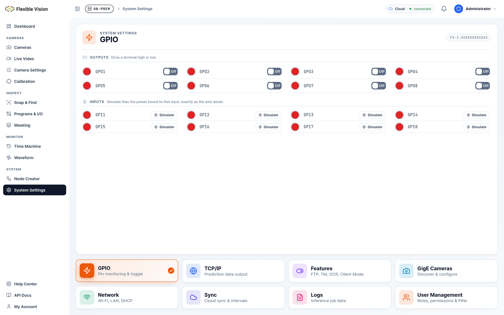

  

  

    <h1 class="big">Release Notes</h1>
    
Updates and Deployment &middot; Flexible Vision v2.0

  

  

<b>Release date</b> &nbsp; 11 November 2026 
<b>Covers</b> &nbsp; March 2026 – November 2026 
<b>Component</b> &nbsp; how software reaches a unit, and how a unit stays connected

<b>About the screenshots in this document.</b> Every screen shown is the real v2.0 interface,
captured from a running unit and from the Flexible Vision Cloud. The product data in them —
part names, counts, defect figures and pass rates — is <b>sample data used for illustration</b>.
It does not represent the performance of any installation.

---

## Summary

This is the part of the platform that installs software on a unit and keeps it linked to the cloud. In v2.0 it learned to do both without an internet connection: a release can be written to a USB stick and installed on a unit that has never been online, and a site running its own local cloud keeps control of its own updates. Alongside that, the connection to the cloud was hardened and the way a unit identifies itself was made stable across updates.

---

## Updates from a USB stick

*The update controls shown in System Settings.*

- **A release can be written to a USB stick** with a single command.
- **The stick carries everything needed**, so a unit with no network at all can be updated from it — including the very first install on an older unit.
- **The update screen shows what is on the stick** before you commit to installing it.
- An update **never inherits settings from a previous run**, so a repeated install behaves the same way every time.

## Updates and rollback

- **Rollback targets are real.** A unit reports what it can actually roll back to, so the option you are offered is one that will work.
- **A site on its own local cloud keeps control of its updates** while it can reach the update service, and is given signed releases.
- **An update replaces every running copy of a service** and never leaves one with nothing running — the failure mode that previously produced a unit that looked updated but was not working.
- **Your existing flows are carried across** an update from older images.

## The connection to the cloud

- **The connection to the cloud is verified** before it is trusted.
- **The on-site message broker is closed to the outside**, reachable only from the unit itself.
- **The connection follows the unit** when it is moved to a different cloud, and repairs itself if the link goes stale.
- **Analytics are sent to the cloud the unit is actually linked to**, rather than a fixed destination.

## Unit identity

- **A unit's identity is fixed once and kept.** It survives updates and re-linking, so a unit does not reappear in your fleet as a new device.
- **Each optional feature reports its own health**, so the cloud can tell the difference between *enabled* and *actually working*.
- A unit **reports its timezone** to the cloud along with what it can do.

## Optional features

Optional features are installed per unit rather than shipped to everyone, so a unit carries only what it is for:

| Feature | Adds | Platform |
|---|---|---|
| **Visual Anomaly** | Defect detection from good samples only | x86 only |
| **Waveform** | Sound and vibration inspection | x86 and ARM |
| **Assembly Guidance** | Worker guidance and the operator kiosk | x86 and ARM |
| OCR Service | Text and characters inside inspections | x86 and ARM |
| Time Machine | Records inspections over time and replays them | x86 and ARM |
| FTP Server | Serves captured images over FTP | x86 and ARM |
| Client Mode | Connects this cell to a master server | x86 and ARM |

Each reports **its own health**, not merely that it is switched on, so the cloud can distinguish *enabled* from *working*.

*Where an operator turns these on, picks a release and installs from USB.*

---

## Fixes

| Fix | What you will notice |
|-----|----------------------|
| Update failed after succeeding | Units in the field could report a failure after an update had in fact completed |
| Partial update | An update no longer leaves a service with no running copies |
| Stale cloud link | A local-cloud connection repairs itself instead of needing intervention |
| Older units | Units on older operating systems start correctly again |
| Repeated installs | An update does not inherit the previous run's settings |

---

## Upgrade notes

- **Units that cannot reach the update service should be updated from a USB stick.** The stick carries everything required, including for a first install.
- **A site on a local cloud** keeps release control only while the update service is reachable.
- **The on-site message broker is now closed to other hosts.** Anything that previously connected to it directly from another machine must go through the unit.
